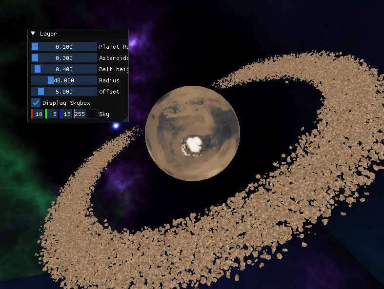

# SaturnRings

OpenGL instancing demo: a Saturn-style asteroid belt and a grass field, rendered with thousands of instanced meshes.

## Build

Requires Windows and Visual Studio 2022.

1. Run `GenerateProject.bat` (generates `Instancing.sln` with the bundled premake5).
2. Open `Instancing.sln`, select **Debug | Win32**, and press **F5**.

## Screenshot

## Controls

| Key | Action |
|---|---|
| `W` `A` `S` `D` | Move |
| `Space` / `Left Shift` | Up / Down |
| `Left Ctrl` | Sprint |
| Mouse | Look around |
| Scroll | Zoom |
| `Tab` | Toggle mouse cursor (to use the ImGui panels) |
| `Esc` | Quit |
